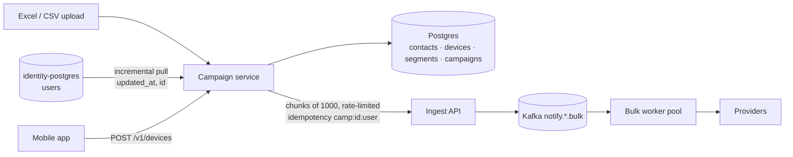

# Notification System: Design for 100M+/day

## 1. Requirements

| | |
|---|---|
| Volume | 100M notifications/day, with growth headroom to 500M |
| Channels | Push (FCM/APNs), Email, SMS, In-app |
| Delivery | At-least-once, effectively-once to the user (dedup) |
| Latency SLO | High priority (OTP, security): p99 < 5s end to end. Normal: p99 < 60s |
| Availability | Ingest API 99.95%. Accepted means durable (never lost after 202) |
| Ordering | Not global. Per-user ordering is best-effort (partition key = user_id) |

## 2. Capacity math

| Quantity | Value |
|---|---|
| Average rate | 100M / 86,400 s ≈ **1,160/s** |
| Daily peak (≈10x avg) | **~12k/s** |
| Campaign burst budget | **50k/s** ingest. Delivery drains from Kafka at provider-limited rate |
| Message size | ~1 KB JSON → ~100 GB/day raw, ~30–40 GB/day with lz4 |
| Kafka storage | 40 GB × RF3 × 3-day retention ≈ **360 GB** |
| Status store | 100M rows × ~300 B × 7-day TTL ≈ 210 GB × RF3 ≈ **630 GB** |
| Worker throughput | Concurrency 1000 × (1 / ~100 ms provider latency) ≈ 10k/s theoretical per pod. Plan **2k/s per pod** |
| Pods at peak | 12k / 2k = 6 → run **8–10 workers** + KEDA to 40 on lag. API: 3–6 pods |

The bottleneck is almost always **provider quotas** (FCM/APNs/SES/Twilio), not Rust or Kafka. Confirm your account limits and set `RATE_LIMIT_*` from them.

## 3. Architecture

```mermaid
flowchart LR
  C[Producers / services] -->|POST /v1/notifications(/batch)| LB[Load balancer]
  LB --> API1[Ingest API<br/>axum]
  LB --> API2[Ingest API]
  API1 & API2 -->|SET NX idem key| R[(Redis cluster<br/>idempotency, dedup, opt-outs)]
  API1 & API2 -->|acks=all, key=user_id| K[(Kafka<br/>notify.channel.priority)]
  K --> WH[Worker pool: HIGH]
  K --> WN[Worker pool: NORMAL]
  WH & WN -->|token bucket| P1[FCM / APNs]
  WH & WN --> P2[SES / SendGrid]
  WH & WN --> P3[Twilio]
  WH & WN --> P4[WebSocket gateway]
  WH & WN -->|transient error| RT[(retry.5s → 1m → 10m)]
  RT --> WR[Worker pools: RETRY<br/>one per tier] --> P1 & P2 & P3 & P4
  WR -->|exhausted / permanent| DLQ[(notify.dlq)]
  WH & WN & WR -->|status| S[(Status store<br/>Redis now · ScyllaDB in prod)]
  API1 & WH & WN & WR -. /metrics .-> PR[Prometheus] --> GF[Grafana + Alertmanager]
```

### Components (in this repo)

| Crate | Role |
|---|---|
| `crates/api` | Validates, enforces idempotency, produces to Kafka, returns 202 after broker ack. Fails fast with 503 + `Retry-After` when the producer queue is full (backpressure). |
| `crates/worker` | Consumes in micro-batches (500 msgs / 20 ms), delivers with bounded concurrency, stores offsets only after the batch completes. Handles TTL expiry, dedup, opt-out, rate limits, provider timeouts, tiered retries, DLQ. |
| `crates/common` | Envelope model, topic naming, tuned Kafka producer/consumer, Prometheus setup, consumer-lag gauge from librdkafka stats. |
| `crates/loadgen` | Synthetic traffic with a realistic channel mix (70% push / 20% email / 5% SMS / 5% in-app, 10% high priority). |

### Topics

| Topic | Partitions (prod) | Purpose |
|---|---|---|
| `notify.{push,email,sms,in_app}.{high,normal}` | 48–96 | Main queues. Isolated per channel so a slow SMS provider can't block push. Isolated per priority so campaigns can't delay OTPs. |
| `notify.retry.5s / 1m / 10m` | 12–24 | Delay queues. The worker sleeps until `not_before_ms`. Records in a tier have equal delay, so FIFO holds. Each tier has its own pool, so short retries never wait behind long ones, and each pool's `max.poll.interval.ms` exceeds its tier's delay. |
| `notify.dlq` | 6 | Exhausted or permanent failures, kept 14 days for inspection and replay. |

Partition count caps consumer parallelism. Size it for the largest pod count you'll autoscale to.

## 4. Key design decisions

1. **Kafka as the durability boundary.** The API acks only after `acks=all` with an idempotent producer, so a 202 means the message survives broker loss.
2. **Idempotency at ingest.** `SET idem:{key} NX EX 86400`. If the Kafka publish fails, the key is deleted so the client's retry succeeds.
3. **Effectively-once at delivery.** Kafka gives at-least-once delivery. The status key `st:{id}` doubles as the dedup marker: a redelivered message already in a terminal state (sent / failed / expired / suppressed) is skipped. The only duplicate window is a crash between the provider ack and the batch's status write (sub-second).
4. **Batch-commit offsets, pipelined.** Offsets are stored only after every message in a batch has a terminal outcome. Each worker keeps `INFLIGHT_BATCHES` (default 4) batches in flight and stores their offsets strictly in batch order. One slow SMS can't stall the consumer, and no message is lost on crash.
5. **O(1) Redis round trips per batch, not per message.** The API pipelines idempotency `SET NX` and `queued` writes per request batch. The worker pipelines its dedup/opt-out pre-check and its status writes per Kafka batch. Load testing showed per-message round trips saturating a single Redis thread at ~12k/s.
6. **Infra failures block; provider failures route.** If Redis or Kafka is down, the worker retries in place, which creates natural backpressure. Provider errors go to retry tiers or the DLQ and never block the partition.
7. **Fail closed on opt-out.** If the opt-out lookup can't be checked, the worker waits rather than risk messaging an unsubscribed user (a compliance concern).
8. **TTL.** OTPs expire (for example after 300 s). Stale notifications are dropped instead of being delivered late.
9. **Priority isolation by deployment.** Separate consumer groups and pods for high, normal, and retry traffic, so each pool scales independently.

## 5. Campaigns (marketing)



- **Audience = `contacts` table** (10M rows is comfortable for Postgres). Fixed columns plus an `attributes` JSONB column with a GIN index, so marketing fields need no migrations.
- **Identity sync**: pulls `users` pages by `(updated_at, id)` past a watermark, re-reads a 2-minute overlap window, and upserts idempotently. It reads only profile columns, never credentials. Identity owns email, phone, name and status. Imports never override identity data but can add attributes. *Limit:* hard deletes aren't seen. Use status changes, a nightly reconcile, or Debezium CDC later.
- **Cohorts**: `all`, `static` (uploaded list), or `rule`. Rules are a JSON DSL compiled to SQL. Fields come from an allow-list and every value is a bound parameter, so marketers can't inject SQL. Preview counts run with a 15-second statement timeout.
- **Campaign runner**: claims due campaigns with `FOR UPDATE SKIP LOCKED` plus a lease, so it's safe with multiple instances. It walks the cohort by keyset (`user_id > cursor`), saves the cursor after every chunk, and applies the per-user daily **frequency cap** with an idempotent Redis SET. It sends through the ingest API on the **bulk** priority lane, with its own topics and worker pool, so transactional traffic is never delayed. Pause, resume and cancel take effect at the next chunk. A replayed chunk can't double-send because the idempotency key is `camp:{campaign}:{user}`.
- **Throughput**: a 10M-user campaign at 5k/s takes ~33 minutes. Speed is set per campaign (`rate_per_sec`) and also bounded by the bulk pool's provider rate limits.
- **Not yet**: quiet hours in each user's timezone, send-time optimization, open/click tracking, A/B variants. The admin UI at `/admin` is one self-contained page (no build step or external scripts, strict CSP). People sign in with email and password. Passwords are Argon2id-hashed, and sessions use an HttpOnly, SameSite=Strict cookie stored as a SHA-256 hash. A same-origin check guards every write, and 5 failed sign-ins lock an account for 15 minutes. There are two roles: admin and marketer.

### Delivery history

Workers publish one `DeliveryEvent` per outcome to `notify.events`. Each event holds the user, channel, template, campaign, attempt, provider, the address used, the failure reason and the latency. The campaign service's history writer batch-inserts these into `delivery_events`, a Postgres table partitioned by day. It stores Kafka offsets only after the insert commits. Retention is `HISTORY_RETENTION_DAYS` (default 7), enforced by dropping old partitions. The admin UI reads the latest event per notification for a person, plus a filterable feed and a summary.

*At full scale:* 100M/day is ~100M rows/day. Postgres handles that with daily partitions on a properly sized instance, but long retention and cross-day analytics belong in **ClickHouse** (or ScyllaDB for per-user lookups). The event stream doesn't change; only the writer's sink does.

## 6. Production hardening (next steps)

- **Redis sizing.** At 100M/day, idempotency keys (24h) plus hot status keys add up to roughly 200M keys and ~30 GB. Use a Redis Cluster with 3–6 primaries and replicas, never one instance.
- **Status/history store → ScyllaDB/Cassandra.** Use `PRIMARY KEY ((user_id, day), id)` with a TTL. Redis keeps only the hot dedup and idempotency keys.
- **Global rate limits.** The current token bucket is per pod (global limit = limit × replicas). For strict provider quotas, use a Redis-based GCRA limiter (for example `redis-cell`) or partition-ownership-based limits.
- **Circuit breaker per provider.** When a provider fails, open the circuit and park traffic in the retry tier instead of hammering it.
- **Real adapters.** FCM HTTP v1 (OAuth2, HTTP/2 multiplexing), APNs (HTTP/2, JWT), SES/SendGrid, Twilio. Classify their errors into Transient and Permanent. For example, APNs `410 Unregistered` is permanent and should also delete the device token.
- **Templates & preferences service.** Render with cached templates (`minijinja`), handle per-user locale, quiet hours, and frequency caps.
- **Campaign fan-out.** For "send to segment X", a planner expands segments in chunks of about 1k users into the normal topic at a controlled rate.
- **Autoscaling.** Use KEDA on `kafka_consumer_lag` for workers and HPA on CPU/RPS for the API.
- **Multi-AZ.** Kafka RF3 with `min.insync.replicas=2`, Redis Cluster with replicas, and pods spread across 3 AZs.
- **Tracing.** OpenTelemetry trace context carried in Kafka headers.

## 7. Monitoring

**Golden signals** (all exported at `/metrics`):

| Metric | Type | Labels |
|---|---|---|
| `notifications_accepted_total` | counter | channel, priority |
| `notifications_rejected_total` | counter | reason (invalid / backpressure / kafka_error) |
| `notifications_processed_total` | counter | channel, outcome (sent / retry / dlq / expired / suppressed / duplicate) |
| `notifications_retried_total` | counter | channel, tier |
| `notification_e2e_latency_seconds` | histogram | channel, priority |
| `provider_request_duration_seconds` | histogram | provider, result |
| `kafka_consumer_lag` | gauge | topic, partition |
| `kafka_produce_duration_seconds` | histogram | topic |
| `http_requests_total`, `http_request_duration_seconds` | counter/hist | route, method, status |
| `worker_rate_limited_total`, `worker_infra_errors_total`, `worker_poison_messages_total` | counter | |

**Dashboard** (`deploy/grafana/dashboards/notifications.json`, auto-provisioned):
Overview SLO tiles (ingest/s, delivered/s, projected/day vs 100M, success %, p99 high-priority latency, backlog) → throughput by channel and outcome → latency percentiles → Kafka lag, retries and DLQ → API and infra health.

Campaign metrics: `campaign_progress_ratio`, `campaign_enqueued_total`, `campaign_suppressed_total{reason}`, `campaign_notifications_total{outcome}` (from workers), `campaign_info{name}`, `identity_sync_rows_total`, `identity_sync_last_success_timestamp_seconds`, `import_rows_total{result}`, `contacts_total_estimate`.

**Alerts** (`deploy/prometheus/alerts.yml`): success < 99%, high-priority p99 > 5s, high-priority backlog > 10k, main backlog > 500k, DLQ > 50/s, API 5xx > 1%, backpressure shedding, provider p99 > 2s, target down.
